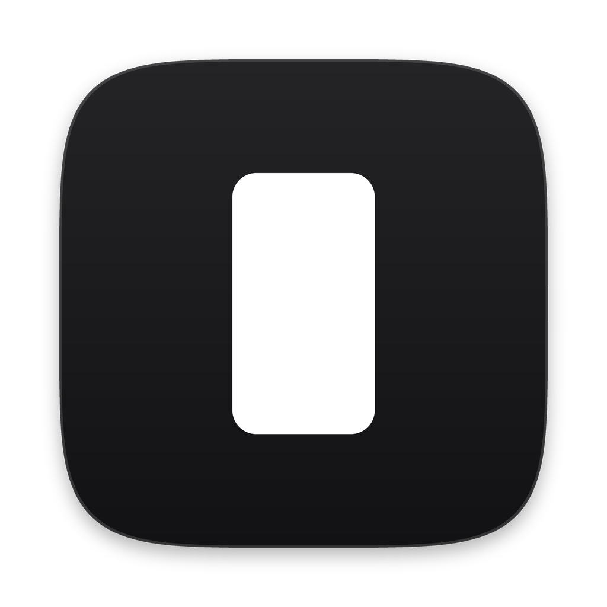
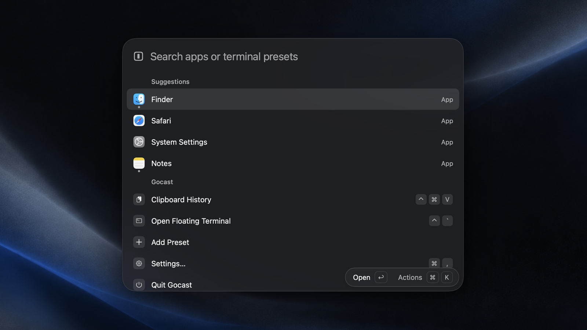

<h1 align="center">
  <a href="https://gocast.yichenlab.com"></a><br>
  Gocast
</h1>

<p align="center">
  One key. Apps and terminal, right there.
</p>

<p align="center">
  <a href="https://gocast.yichenlab.com"><strong>Website</strong></a> ·
  <a href="#install"><strong>Install</strong></a> ·
  <a href="https://gocast.yichenlab.com/changelog/"><strong>Changelog</strong></a> ·
  <a href="https://gocast.yichenlab.com/support/"><strong>Support</strong></a>
</p>

<p align="center">
  <a href="https://github.com/xcc3641/gocast/releases/latest"></a>
  <a href="https://github.com/xcc3641/gocast/actions/workflows/ci.yml"></a>
  
  
  <a href="LICENSE"></a>
</p>

<p align="center">
  English · <a href="README.zh-Hans.md">简体中文</a>
</p>

<p align="center">
  
</p>

Gocast is a small, native launcher for the Mac. Press ⌘Space to open any app, ⌃\` for a terminal that drops down from the top of the screen, and ⌃⌘V for everything you copied. Type math, units or currencies in the same search field and the answer is already there.

No account, no data collected, free and open source.

[See everything it does →](https://gocast.yichenlab.com)

## Install

**Disk image.** Download the latest `.dmg` from [Releases](https://github.com/xcc3641/gocast/releases/latest), open it, and drag Gocast to Applications. It is notarized by Apple, so it opens with a double-click.

**Terminal.** One line. It downloads the latest release, checks it is the official build, puts it in Applications (or `~/Applications`), and opens Gocast. No admin password. You can read the [install script](install.sh) first.

```sh
curl -fsSL https://github.com/xcc3641/gocast/releases/latest/download/install.sh | sh
```

To uninstall:

```sh
curl -fsSL https://github.com/xcc3641/gocast/releases/latest/download/install.sh | sh -s -- --uninstall
```

Your presets, settings and clipboard history stay.

Requires macOS 13 or later on Apple silicon. Spotlight uses ⌘Space by default, so Gocast starts on ⌥⇧Space until you turn Spotlight's shortcut off; [here's how](https://gocast.yichenlab.com/support/).

## Your data

Gocast only goes online to check for updates and to fetch exchange rates once a day, and both can be turned off. Your presets, settings, clipboard history, and a record of what you open from search and the words you typed to find it (so your usual picks come first; the words are kept for 17 days) all stay in `~/Library/Application Support/com.hugo.gocast/` and are never uploaded. [Privacy policy →](https://gocast.yichenlab.com/privacy/)

## Contributing

Bug reports and ideas are welcome in [Issues](https://github.com/xcc3641/gocast/issues). To build from source or send a change, start with [CONTRIBUTING.md](CONTRIBUTING.md).

## Thanks

Built with [MyGo](https://github.com/egoist/mygo). The terminal runs on libghostty-vt from [Ghostty](https://ghostty.org), pinyin search uses [go-pinyin](https://github.com/mozillazg/go-pinyin), and exchange rates come from [Frankfurter](https://frankfurter.dev). Inspired by Raycast and Ghostty's quick terminal; not affiliated with either.

## License

[Apache License 2.0](LICENSE). Bundled software is listed in [NOTICE](NOTICE) and [THIRD_PARTY_NOTICES.md](THIRD_PARTY_NOTICES.md).
