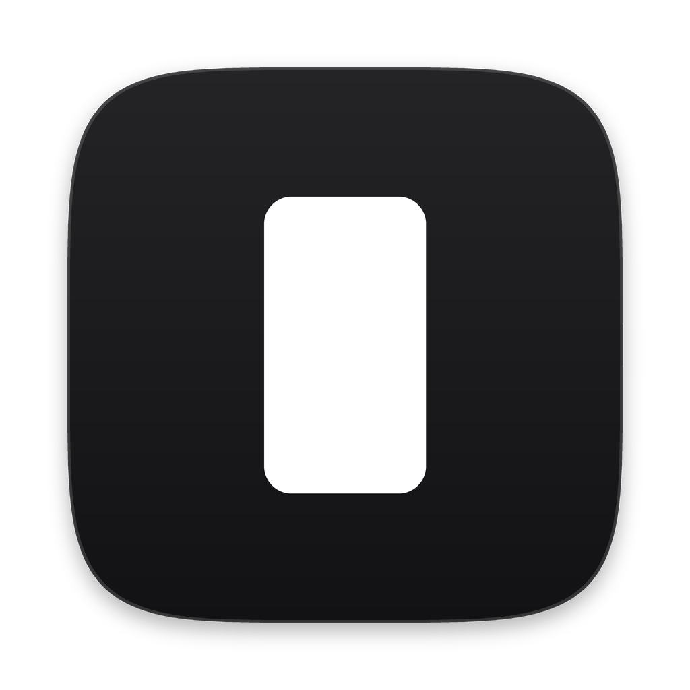
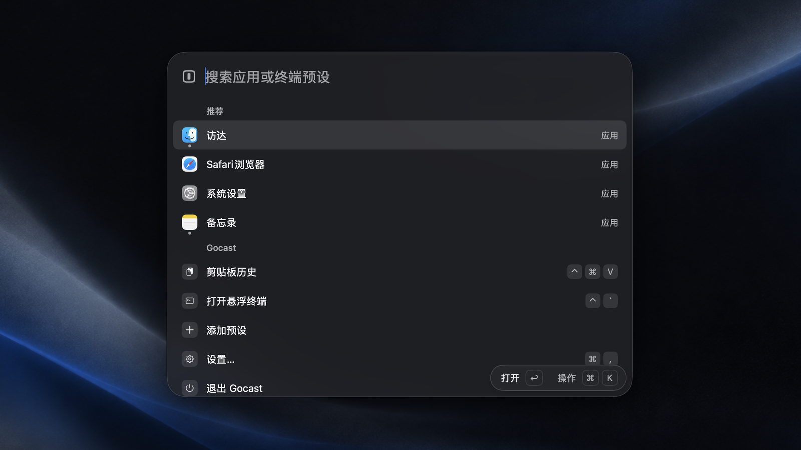

<h1 align="center">
  <a href="https://gocast.yichenlab.com/zh/"></a><br>
  Gocast
</h1>

<p align="center">
  按一下，应用和终端都到。
</p>

<p align="center">
  <a href="https://gocast.yichenlab.com/zh/"><strong>网站</strong></a> ·
  <a href="#安装"><strong>安装</strong></a> ·
  <a href="https://gocast.yichenlab.com/zh/changelog/"><strong>更新日志</strong></a> ·
  <a href="https://gocast.yichenlab.com/zh/support/"><strong>支持</strong></a>
</p>

<p align="center">
  <a href="https://github.com/xcc3641/gocast/releases/latest"></a>
  <a href="https://github.com/xcc3641/gocast/actions/workflows/ci.yml"></a>
  
  
  <a href="LICENSE"></a>
</p>

<p align="center">
  <a href="README.md">English</a> · 简体中文
</p>

<p align="center">
  
</p>

Gocast 是一个 Mac 上的原生小启动器。按 ⌘Space 打开任何应用，按 ⌃\` 让终端从屏幕上方落下来，按 ⌃⌘V 找回拷贝过的东西。在同一个搜索框里打算式、单位或汇率，答案直接就在。

没有账号，不收集数据，免费开源。

[看看它能做的全部 →](https://gocast.yichenlab.com/zh/)

## 安装

**磁盘映像。** 到 [Releases](https://github.com/xcc3641/gocast/releases/latest) 下载最新的 `.dmg`，打开后把 Gocast 拖进“应用程序”文件夹。安装包经过 Apple 公证，双击就能打开。

**终端。** 贴一行就装好。它下载最新版，核对是官方发布的，放进“应用程序”（或 `~/Applications`），然后打开 Gocast，不用管理员密码。可以先看看[安装脚本](install.sh)。

```sh
curl -fsSL https://github.com/xcc3641/gocast/releases/latest/download/install.sh | sh
```

卸载：

```sh
curl -fsSL https://github.com/xcc3641/gocast/releases/latest/download/install.sh | sh -s -- --uninstall
```

预设、设置和剪贴板历史会留着。

需要 macOS 13 或更高版本，Apple 芯片。系统默认把 ⌘Space 给了聚焦搜索，所以在你关掉聚焦的快捷键之前，Gocast 先用 ⌥⇧Space；[怎么关](https://gocast.yichenlab.com/zh/support/)。

## 你的数据

Gocast 只在检查更新和每天取一次汇率时联网，两样都能关。预设、设置、剪贴板历史，还有你从搜索里打开过什么、用哪个词打开的（用来把常用的排前面，搜索词只留 17 天），都在 `~/Library/Application Support/com.hugo.gocast/`，不会上传。[隐私政策 →](https://gocast.yichenlab.com/zh/privacy/)

## 参与

发现问题、有想法，欢迎提到 [Issues](https://github.com/xcc3641/gocast/issues)。想从源码构建或提交改动，先看 [CONTRIBUTING.md](CONTRIBUTING.md)。

## 致谢

Gocast 用 [MyGo](https://github.com/egoist/mygo) 写成。终端用的是 [Ghostty](https://ghostty.org) 的 libghostty-vt，拼音搜索用的是 [go-pinyin](https://github.com/mozillazg/go-pinyin)，汇率来自 [Frankfurter](https://frankfurter.dev)。受 Raycast 和 Ghostty 快捷终端的启发，与两者都没有关联。

## 许可证

[Apache License 2.0](LICENSE)。附带的第三方软件见 [NOTICE](NOTICE) 和 [THIRD_PARTY_NOTICES.md](THIRD_PARTY_NOTICES.md)。
